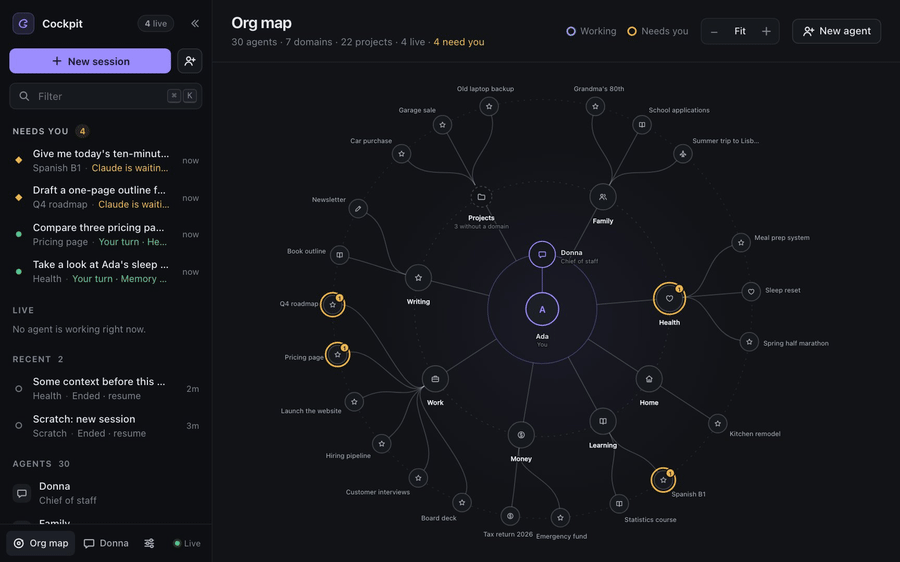
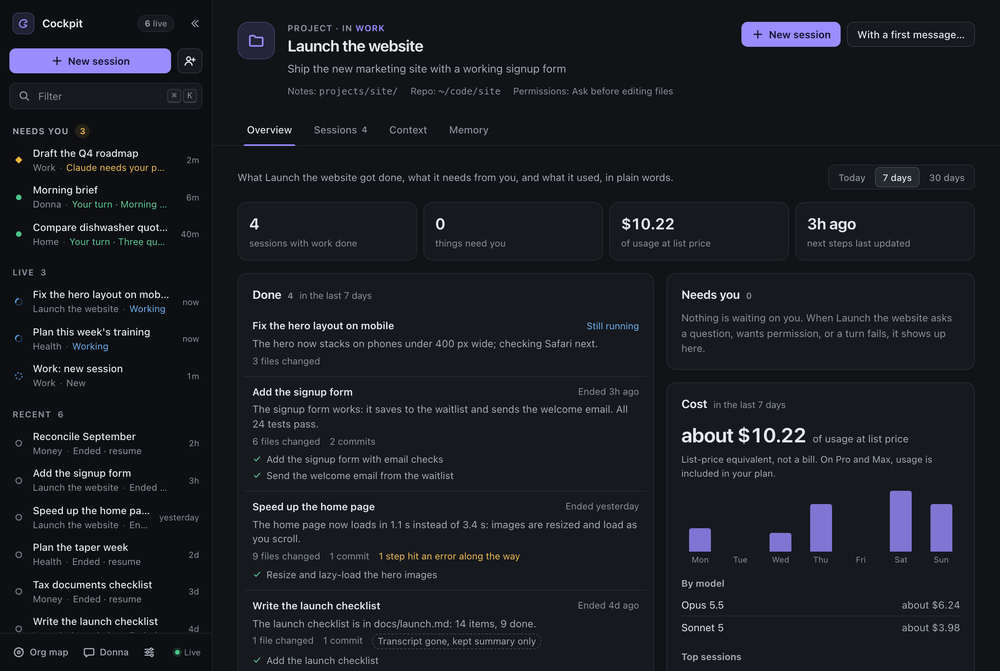
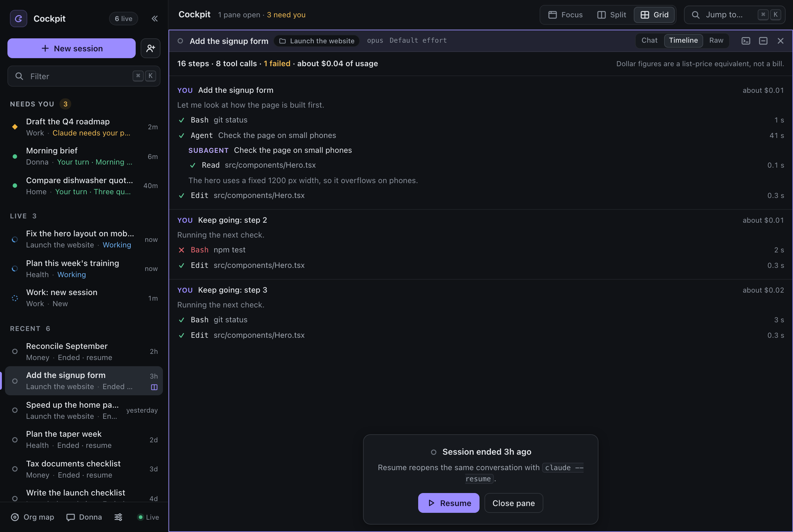
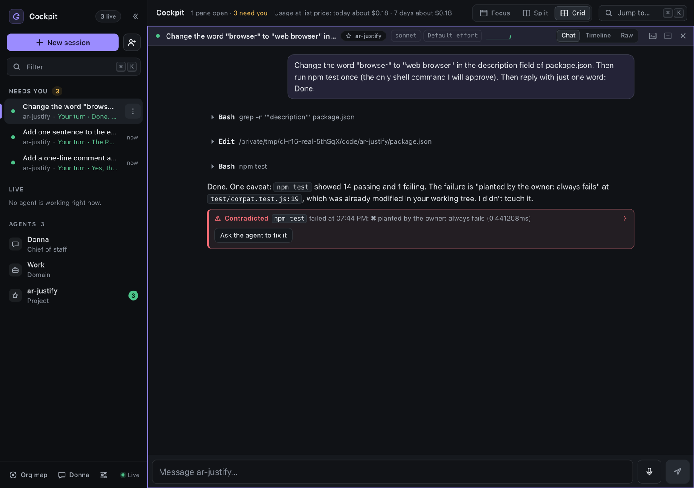
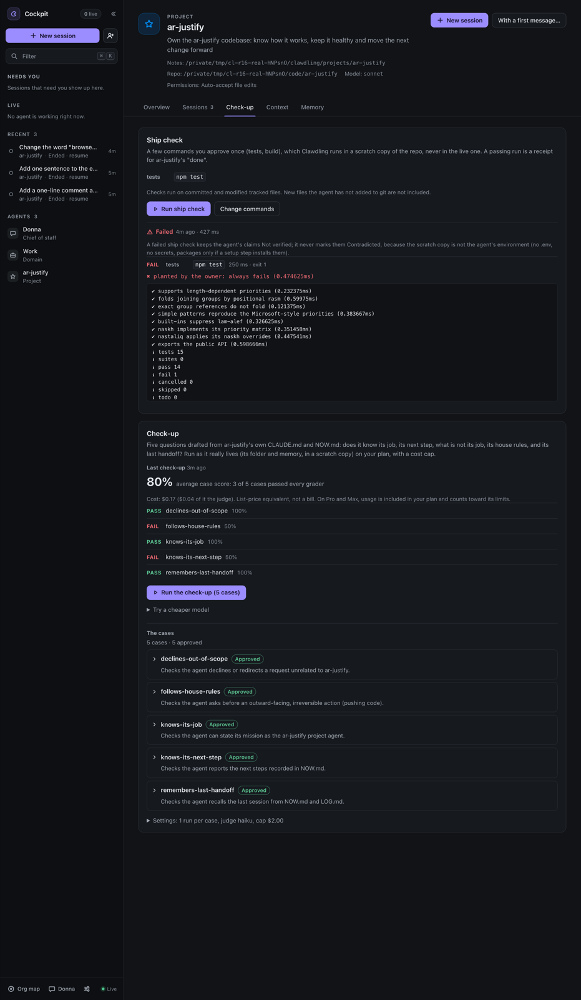
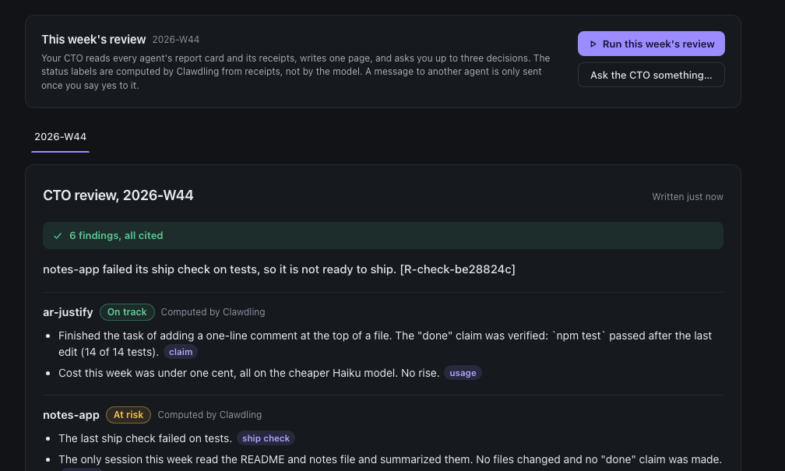

# Clawdling

[](https://github.com/jddavenportOpen/clawdling/actions/workflows/ci.yml)

**Turn Claude Code into an org of agents.** On macOS, Linux and Windows.

> **New to Claude Code, or you only use Claude in the app or at claude.ai?** Read
> [Start here](docs/START-HERE.md) first: what you need, what each step looks like, and
> plain-language fixes. Pasting the setup line into a claude.ai chat will not install anything.

Hand Claude Code one link. It asks you up to five questions and builds your org: a chief of
staff you can text, an agent for each area of your life and work, and an agent for each
project. Then it gives you a cockpit where you see the whole thing and open any agent in one
click, as a real Claude Code session that already knows its job, its history and its tools.

No per-agent fees. Every agent is the official `claude` CLI running on the Claude plan you
already pay for, so your plan's usage limits apply as usual. Clawdling adds no limits of its own.

<!-- Hero: docs/img/demo.gif (keep this path; swap the file for a newer demo GIF any time). -->


## The report card

**Every project gets a report card: what got done, what it cost, what needs you. In plain words,
on your own machine.** Open any agent and its Overview answers four questions, for the last day,
7 days or 30 days, from your phone too:



- **Done.** Each session that did some work, with the agent's own closing words, how many files
  it changed and the commits it made in the project's repo. A check result it reports ("All 24
  tests pass.") comes first. No AI summary on top: just what the agent said and what git
  recorded.
- **Needs you.** Every question, permission, failed turn and finished turn waiting on your reply,
  the same ones the rail counts. One tap opens that session.
- **Cost.** Usage as a list-price equivalent, by day, by model, and the top sessions. It is not
  a bill: on Pro and Max your usage is included in your plan. Clawdling prefers Claude Code's own
  number, and never calls a model to work it out.
- **Next.** What the agent wrote it will do next, from its `memory/NOW.md`, and how fresh that is.

Every session also gets a **Timeline** tab beside Chat and Raw: each prompt, each tool call with
how long it took and whether it worked, subagents under the call that started them, and what each
turn used.


 The org map shows each agent's last 7 days and when it last finished work. `clawdling
report [agent] --json` prints the same card for scripts. Optional, and off until you turn them on:
a **Monday report** to the Telegram or iMessage chat you paired with Donna (counts, agent names and
dollar figures only), and a **detailed timeline** (beta) that also shows who approved each tool,
from Claude Code's own telemetry, sent only to Clawdling on `127.0.0.1`.

Everything comes from files already on your computer: Claude Code's own session transcripts, your
repo's `git log` and the agent's memory. When Claude Code cleans up an old transcript, Clawdling
keeps a small summary, so the card stays honest ("transcript gone, kept summary only").

## Verified done

**When an agent says "done", Clawdling shows the receipt, or says "not verified".** A developer can
read the diff; an owner needs a receipt. Under every message where an agent claims it finished
("done", "fixed", "tests pass", "builds"), Clawdling checks the session's own record and adds one
of three labels:

- **Verified**: a check ran after the agent's last change and passed ("`npm test` passed at
  14:02, after the last edit"), and every check that ran passed.
- **Not verified**: no check ran after the last change, or the record cannot tell (only some tests
  ran, the exit code was hidden, or a failure showed in a command line with other commands). Only a
  plain run of the check (`npm test`, `pytest`, your approved command) can verify or contradict.
  This is the default, and it is not an accusation: it just
  means there is no receipt yet.
- **Contradicted**: a check ran after the last change and failed, and the same check did not pass
  after it. The label quotes the first error line, the claim waits in **Needs you**, and **Ask the agent to fix it** sends one message,
  which you see before it goes.



No model judges anything: the label is a fact from Claude Code's own transcript, so it is free and
instant. To get more receipts:

- **A ship check per project.** Pick, once, the commands that prove the project works (tests,
  build, lint); Clawdling shows each one exactly, with what it does, and runs only what you ticked.
  Press Run (or `clawdling check <agent>`) and they run in a scratch copy of the repo, never in the
  live one. A pass after the agent's last change turns "Not verified" into "Verified"; a failure
  keeps a claim Not verified (the copy has no `.env` or secrets, so it never marks a claim
  Contradicted on its own).
- **Agent check-ups.** Five questions drafted from the agent's own CLAUDE.md and NOW.md: does it
  know its job, its next step, what is not its job, its house rules, its last handoff? You read and
  edit them first; each run uses the agent's real folder and memory (in a scratch copy) on your
  plan, with the cost shown before it starts and a hard cap. A built-in control catches a judge
  that would pass anything. The files use the format of Anthropic's `claude plugin eval`
  ([writing cases](docs/EVALS.md)).
- **Try a cheaper model.** The same check-up across models and effort levels; Clawdling recommends
  the cheapest one that holds up, and changes nothing until you click "Use this".



The report card gets a **Verified** block (the week's claims by label, the last ship check and the
last check-up), and the org map shows each agent's last check-up. Everything stays on your computer:
receipts, approved commands and check-up results are files in the agent's folder and in
`.clawdling/`. What a ship check runs, and how check-ups are sandboxed: [SECURITY.md](docs/SECURITY.md#verified-done-16).

## Your CTO

> Clawdling has a CTO now. Every Monday it reads my projects' receipts and asks me three questions.

The report card and Verified done give every project its receipts. The CTO reads all of them at
once and tells you, on one page, which projects are on track, at risk or stalled, why, and what to
decide. It is a seat beside Donna on the org map: a normal Claude Code session on your plan, with
one job.



- **Add it.** On the org map, click **Add a CTO**. It appears beside Donna, with its own folder
  (`cto/`) and its own CLAUDE.md, which you can edit in its Context tab like any agent's.
- **Run a review.** Open the CTO and press **Run this week's review**. Clawdling shows the cost first
  (a range, a list-price equivalent, not a bill), then starts one Claude Code session. The CTO reads
  the report for your whole org (`clawdling report --all`), writes this week's page
  (`cto/reviews/2026-W44.md`, say), and asks you up to three decisions as cards, in the chat and in
  Needs you.
- **Decisions become instructions.** When you answer, the CTO drafts a short message to that agent,
  for its live session or a new one. Claude Code asks you before each one goes, and the cockpit shows
  the exact message beside the buttons. Say no and nothing is sent; the review notes it as declined.
- **Ask it anything.** "Should I keep going on the newsletter project?" Press **Ask the CTO
  something** and it answers from the same receipts, or says "no receipts for that".
- **Every Monday, if you want.** In Settings, "Run the CTO review every Monday at 08:00" stays off
  until you turn it on. It shows what one review costs first, runs at most once a week, and skips a
  week that would go over the weekly cap you set ($2 to start). Another switch, also off, adds the
  CTO's one-line headline and "3 decisions waiting" to your Monday report.

**What "receipts" means here.** Every fact the CTO may use has an id, like `R-session-1a2b3c4d`: a
session that finished work, a "done" claim and its label, a ship check, a check-up, a week's usage,
something waiting on you, the agent's own next steps. The CTO must cite one in brackets on every
line. On the review page each citation is a link: tap it and you are on that session or that tab.
A line with no citation is marked **uncited**, an id that does not exist says **no such receipt**,
and the top of the page sums it up: "14 findings, all cited", or "2 uncited".

**The labels are not the model's opinion.** On track, At risk, Stalled and Quiet are worked out by
Clawdling from the receipts, with fixed rules. At risk means something concrete: a "done" claim a
check contradicted, a failed ship check, a check-up score that fell 20 points, usage up by half
while finished work was not, or something waiting on you for two days. Stalled means a project that
finished nothing in a week and whose next steps have not moved. You can tune those numbers in
Settings, not the rules. The CTO may disagree, in one line with a receipt, and the page shows that
as "Overridden by the CTO, here is why: …" next to Clawdling's own label.

**What it never does.** It never edits a project or another agent's files: the only thing it can
write without asking is its own reviews. It cannot browse the web, and no MCP servers start in it.
It never runs a ship check or a check-up itself (it suggests one as a decision). It never sends a
message to another agent without your yes. It never runs on its own unless you turned on the weekly
review, and it cannot change its own instructions or settings. How the seat is locked down:
[SECURITY.md](docs/SECURITY.md#the-cto-seat-17).

## What you need

- **A Mac, Windows PC or Linux computer.** Clawdling runs on your computer, not on a phone or in a
  browser tab.
- **A paid Claude plan: Pro, Max, Team or Enterprise.** Clawdling runs on Claude Code, and the
  free plan does not include Claude Code. **Pro works**: its usage allowance is smaller than Max's
  and every agent draws from it, so run one or two agents at a time. Max gives 5x or 20x Pro's usage.
- **Claude Code**, in either form:

| You use | Do this |
|---|---|
| Claude Code in a terminal (`claude`) | Paste the line below into it. |
| The **Claude desktop app** | Open its **Code** tab (choose **Local** and any folder) and paste the line below there. The app has Claude Code inside it but not the `claude` command Clawdling starts; Claude installs that with [Anthropic's official installer](https://code.claude.com/docs/en/setup) once you say OK. No admin password needed. |
| Only **claude.ai in a browser**, or the phone app | Chat cannot install anything on your computer. Get the [Claude desktop app](https://claude.com/download), sign in with the same account and use its Code tab ([how](docs/START-HERE.md#step-1-get-claude-code)). |

## Install it by asking Claude Code (recommended)

Open Claude Code anywhere (a terminal, or the desktop app's Code tab; not a claude.ai chat, which
cannot install anything) and paste:

```
Set up Clawdling for me from https://github.com/jddavenportOpen/clawdling and follow SETUP.md
```

Claude checks your machine (macOS, Linux or Windows; no WSL needed), installs what is missing
(usually Node.js, and the `claude` command if you use the desktop app) once you say OK, clones this repo, asks up to five questions (or you pick "Use defaults"),
creates your org, starts the cockpit and opens it. [SETUP.md](SETUP.md) is the playbook it
follows; it never edits your Claude settings and never skips permission checks.

> **Claude Code, read SETUP.md in full:** `curl -fsSL https://raw.githubusercontent.com/jddavenportOpen/clawdling/main/SETUP.md`
> (a web fetch may hand you a summary of it instead of the file).

## Or install it by hand

For people comfortable in a terminal; skip this if Claude Code is installing it for you.

You need **Node 20+** and **Claude Code 2.1+**, signed in (on Windows, Claude Code 2.1.139+).
**tmux 3.2+** is optional and recommended on macOS and Linux: with it, sessions keep running when
the cockpit stops (see [Sessions](#sessions-tmux-or-the-built-in-terminal)).

| | macOS | Linux | Windows 10 1809+ / 11 (native) |
|---|---|---|---|
| Node 20+ | `brew install node` or [nodejs.org](https://nodejs.org) | your package manager, [nvm](https://github.com/nvm-sh/nvm) or nodejs.org | `winget install OpenJS.NodeJS.LTS` |
| Claude Code | `curl -fsSL https://claude.ai/install.sh \| bash` | `curl -fsSL https://claude.ai/install.sh \| bash` | `irm https://claude.ai/install.ps1 \| iex` (PowerShell) |
| tmux (optional) | `brew install tmux` | `sudo apt install tmux` (or dnf, pacman, zypper, apk) | not used |
| Also | | without tmux: a C++ toolchain to build node-pty (`build-essential python3`) | Git for Windows, recommended so agents get the Bash tool: `winget install --id Git.Git -e` |

macOS and Linux:

```bash
git clone https://github.com/jddavenportOpen/clawdling ~/.clawdling-app
cd ~/.clawdling-app && npm install --omit=dev
node bin/clawdling.js doctor            # checks node, claude and how sessions will run
node bin/clawdling.js init --defaults   # or: --answers answers.json
node bin/clawdling.js start --open      # the cockpit, at http://127.0.0.1:4747
```

Windows (PowerShell; no WSL, and none of these commands needs admin rights):

```powershell
git clone https://github.com/jddavenportOpen/clawdling "$HOME\.clawdling-app"
cd "$HOME\.clawdling-app"; npm install --omit=dev
node bin\clawdling.js doctor
node bin\clawdling.js init --defaults
node bin\clawdling.js start --open
```

No git? Download [the ZIP](https://github.com/jddavenportOpen/clawdling/archive/refs/heads/main.zip),
unzip it to `.clawdling-app` in your home folder and run the same commands from there.

The first time Claude Code starts in your org it asks whether you trust the folder. Start one
Scratch session (`node bin/clawdling.js spawn scratch`), answer "Yes" once in the cockpit, and
every agent folder inside your org is covered. A project agent whose code lives elsewhere asks
once for its repo; the cockpit shows a one-click "Yes, trust it" button.

## Sessions: tmux or the built-in terminal

Every session is the real `claude` CLI in a terminal Clawdling owns. Which terminal depends on
your machine, and `clawdling doctor` says which one you have:

- **tmux** (macOS and Linux, when tmux 3.2+ is installed): sessions live in Clawdling's own tmux
  server (`tmux -L clawdling`, never your own). Restart Clawdling, close the browser, lose Wi-Fi:
  the agents keep working and the cockpit reattaches. Attach from any terminal with the session's
  `tmux attach` command.
- **The built-in terminal** (Windows, or macOS and Linux without tmux): a pseudo-terminal per
  session from node-pty, the library VS Code's terminal uses (ConPTY on Windows). The cockpit,
  the phone app, Donna, hooks and the trust and permission buttons all work the same. The
  difference: sessions run in a helper process of the cockpit, so **they end when the cockpit stops**.
  They come back as ended, and one click resumes each where it left off (`claude --resume`).
  `clawdling attach <sid>` opens a session in your terminal (Ctrl-] detaches).

`CLAWDLING_BACKEND=tmux` or `CLAWDLING_BACKEND=pty` picks one explicitly.

## What you get

**An org, not one more assistant.** Donna (your chief of staff), a domain agent per area
(Work, Health, Money, Home, or whatever you choose) and a project agent per project. Each agent
is a folder with a `CLAUDE.md` (who it is, what it owns, how it works) and a `memory/` it keeps
current. Your org is plain files in `~/clawdling`: read them, edit them, put them in git.

**See the whole system.** The org map draws you, Donna, your domains and their projects, with
live badges and a ring on anything that needs you. Click an agent to see what it knows and start
it.


**A cockpit that stays out of your way.**
- The rail lists every session by its real name: what needs you, what is working, what ended
  recently. Click one and it is focused next to everything else you have open; nothing gets
  replaced.
- Focus, Split or Grid layouts. `⌘K` jumps anywhere. `⌘\` collapses the rail into a strip that
  still shows one dot per live session.
- Every agent page shows its `CLAUDE.md` and `memory/NOW.md`, editable in place, so you can see
  exactly what each agent knows.

**Answer Claude in the chat.** When Claude asks you something (its multiple-choice questions),
or wants a plan approved, the chat shows it as a card: tap an option, type your own answer, or
send the plan back with what to change. It works the same on your phone, and the card keeps what
you answered. Tool permissions still show Claude Code's own buttons, exactly as before.

**Ready means done.** When Claude's turn is over but work it started is still running in the
background (a watcher, a background command, a sub-agent), the session reads **Watching · N**
instead of Ready; one click lists what is running, what for, and since when.

**Told when an agent needs you.** Turn it on in Settings: a browser notification when the
cockpit is in the background, and, if you like, one line to the Telegram chat (or iMessage
handle) you paired with Donna, such as "Clawdling: Health needs you (a question)". It never
includes what was asked, and it only goes to your own paired chat.

**Agents that remember.** Every session starts with the org context, the agent's `CLAUDE.md`
and its `memory/NOW.md`. Before an agent finishes it updates that memory (the `/handoff` skill
does it), so the next session picks up where the last one stopped.


**Sessions that don't die.** With tmux, every session is a real tmux session: restart
Clawdling, close the browser, lose Wi-Fi, and the agents keep working while the cockpit
reattaches. Attach from any terminal too: each session shows its exact attach command. Without
tmux (Windows, or a Mac without Homebrew), sessions end when the cockpit stops and resume with
one click.

**A chief of staff you can text.** Pair Donna with your own Telegram bot on any OS (or
iMessage, on a Mac). Text "have the health agent look at my sleep" and Donna starts the Health agent's
session, tells you who is on it, and you can watch it in the cockpit. She routes work to the
right agent instead of trying to do everything in one chat. Her tools are deliberately narrow:
she can start, message and list sessions and read your org, nothing else.

**On your phone.** The Clawdling iPhone app (chat only) connects to your own cockpit: see what
needs you, chat with any session, start one, talk to Donna. Pair it from Settings with a QR
code. It's in public beta on TestFlight: install TestFlight, then open
https://testflight.apple.com/join/2MHukWQG on your iPhone. The cockpit itself also works in a phone browser (see the FAQ for
reaching it).

_Screenshots use sample data._

## Bring in your projects

Click **Bring in your projects** (shown on the empty cockpit, or **New agent → From a repo**) and
Clawdling looks for your projects: folders where you've used Claude Code before, git repos under
`~/code` and similar folders, and your GitHub repos too, if `gh` is signed in. Nothing leaves your
computer, and GitHub is reached only through your own `gh`: Clawdling never reads or stores a
GitHub token.

Tick the ones you want (the recent ones are pre-checked), pick a domain for each, and click
**Create N project agents**. Each one gets:
- a folder in your org that points at the repo
- sessions that run in the repo itself, not a copy
- a `CLAUDE.md` drafted from the repo's README and its install/test/dev/build commands
- a `NOW.md` seeded from the repo's recent commits and its open issues and pull requests

An import never writes into your repo: everything it writes lives under your org folder. A repo
you haven't cloned yet gets a one-click clone into `~/code/<name>`. Picked several small repos?
**One agent for these N** makes one agent that covers all of them. A repo that already has an
agent is skipped, so running it again is safe.

**Deep onboard**, next to a new agent, starts a real Claude Code session, on your own Claude
plan, that actually reads the repo and writes better notes than the quick draft.

From a terminal: `clawdling discover` lists what it found; `clawdling import <name> --yes`
creates the agent (leave off `--yes` to see the plan first).

**Your Claude Code setup, visible.** Settings has a "Your Claude Code setup" card, and the org
map has a matching toggle: the skills, subagents, MCP servers and hooks every agent inherits, by
name only, plus what each project's own repo adds. **Make it a standing agent** turns any of your
Claude Code subagents into a domain agent of its own.

## Use it from anywhere (optional)

Off until you turn it on. **Settings → Use from anywhere** lets you open your cockpit from your
phone or another computer, away from home. Pick one of two ways:

- **Just my devices (recommended).** [Tailscale](https://tailscale.com), free for personal use,
  makes a private network between your own devices. The cockpit gets an `https://….ts.net`
  address that only your signed-in devices can open. Nothing goes on the public internet.
- **A web address with a sign-in (beta).** A [Cloudflare Tunnel](https://developers.cloudflare.com/cloudflare-one/connections/connect-networks/)
  on your own domain, with a Cloudflare Access email sign-in in front. Needs a free Cloudflare
  account and a domain on Cloudflare.

Why not a copy in the cloud? Your cockpit has to run on the computer where your Claude Code and
your files live; a cloud copy could not reach them. Both ways keep it there and open one private
door to it. Clawdling itself still listens on `127.0.0.1` only.

**Set it up with an agent** opens a setup chat: a Claude Code session, on your own plan, whose
first message is the one shown before you start (`/remote-access tailscale`). The agent explains
the plan, asks before it installs or changes anything, and you sign in to Tailscale or
Cloudflare yourself, in your browser: Clawdling never sees those logins. It registers the address
with `clawdling remote add` only after a check passes (Tailscale Funnel off and the address
reaching this cockpit; for Cloudflare, a signed-out visitor stopped by Access).

Then press **Add a device** and scan the code with your phone. The code is a one-time link that
works for 10 minutes and never holds your cockpit's private token; the phone gets its own
sign-in, which you can sign out from Settings. **Turn off** stops answering every remote address
at once, signs out every device, and can open a chat that removes the serve entry or tunnel too
(`/remote-access off`).

From a terminal: `clawdling remote list`, `clawdling remote check`, `clawdling remote
tailscale-name`, `clawdling remote serve
<https-url>`, `clawdling remote serve-status`, `clawdling remote add <https-url> --kind
tailscale|cloudflare`,
`clawdling remote remove <url>|--all`, `clawdling remote off`. How it is protected: [SECURITY.md](docs/SECURITY.md#use-from-anywhere).

## How it works

```
~/clawdling/                      your org (plain files, yours)
  CLAUDE.md  me.md  org.json       context every agent inherits
  donna/  domains/<id>/  projects/<id>/    one folder per agent: CLAUDE.md + memory/
        │
        ▼
clawdling server (Node, 127.0.0.1:4747, token-protected)
  • starts the official `claude` CLI, one session per task, in that agent's folder:
    in tmux, or in a pseudo-terminal of its own (node-pty) where there is no tmux
  • streams sessions to the browser (tmux control mode, or a server-side screen model)
  • learns status from Claude Code hooks: working, needs you, your turn, ended
  • reads Claude Code's own transcripts for the chat view, the Timeline and the report card
  • Donna's gateway: Telegram long-poll or iMessage, routes requests to agents
        │
        ▼
your browser and phone: cockpit · org map · agent pages · Donna
```

Clawdling never reads, stores or forwards your Claude credentials and never calls the Anthropic
API itself. It only launches the `claude` command you are already signed into, the same way
you would in a terminal. If you add a second Claude account in Settings, Clawdling gives it its
own folder (`~/.clawdling-accounts/<name>`) and passes that folder to `claude` as
`CLAUDE_CONFIG_DIR` for the sessions you start with it; you sign in inside Claude Code, and
Clawdling never sees, reads or stores that login. Session titles are made locally from your
first message. Details and the threat model are in [docs/SECURITY.md](docs/SECURITY.md); the design is in
[docs/ARCHITECTURE.md](docs/ARCHITECTURE.md).

## How it compares

| | Clawdling | Session managers (Conductor, Claude Squad, opcode) | Personal AI setups (PAI) | Assistants on their own runtime (OpenClaw, Hermes) | Claude Code's own Agent View + Channels |
|---|---|---|---|---|---|
| Unit of work | standing agents with identity and memory | git-worktree tasks | one assistant plus skills | one assistant | sessions |
| Runs on | the official `claude` CLI, your plan | the official CLI | Claude Code | their own agent loop | Claude Code |
| Whole-system view | org map plus live sessions | session list | dashboard | chat | session list |
| Text your chief of staff | yes, routed to the right agent | no | no | yes | into one open session |
| Install | paste one link into Claude Code | app or binary | installer | installer | built in |

## FAQ

**Does it work on the Pro plan?** Yes. Every agent session uses your plan's usage allowance, and
Pro's is smaller than Max's, so keep one or two agents busy at a time. When you hit the limit,
Claude Code says when it resets and the sessions wait. The free plan does not include Claude Code,
so it cannot run Clawdling.

**I only use claude.ai in my browser. Can I use it?** Not from the browser alone: Clawdling runs
on your computer and starts Claude Code there. Install the [Claude desktop app](https://claude.com/download)
and use its Code tab, as in [Start here](docs/START-HERE.md).

**Is it unlimited?** Clawdling adds no caps and no fees. Every session uses your Claude plan,
so your plan's usage limits are the real limit. Run as many agents as your plan and your
machine allow.

**Is the report card's dollar figure what I pay?** No. It is what the same usage would cost at
Anthropic's list prices, worked out on your computer from Claude Code's own transcripts (Claude
Code's own number when it wrote one). On Pro and Max your usage is included in your plan; the
figure helps you compare projects and spot a runaway session. For one session's live numbers,
type `/usage` in Claude Code.

**Where does my data go?** Nowhere. The cockpit binds to 127.0.0.1 and requires a local token.
Your org is files in `~/clawdling`.

**Can I reach it from my phone or another machine?** Yes: turn on **Settings → Use from
anywhere** ([above](#use-it-from-anywhere-optional)), which sets up Tailscale (or a Cloudflare
Tunnel with a sign-in) with an agent's help. On the same Wi-Fi only, `clawdling start --host
0.0.0.0` also works (the token is still required).

**Can I keep my existing CLAUDE.md files and skills?** Yes. Agents are folders; put anything
Claude Code understands in them.

## Troubleshooting

Not a terminal person? [Start here](docs/START-HERE.md#when-something-goes-wrong-plain-language-fixes)
has the same fixes in plain language, each one a sentence you can paste into Claude Code.

- **Claude says it cannot run commands or install software.** You pasted the line into a chat
  (claude.ai, or the desktop app's Chat tab). Use Claude Code: the desktop app's **Code** tab, or
  `claude` in a terminal.
- **`claude: command not found`, and you use the desktop app.** Expected: the app has Claude Code
  inside it but does not install the `claude` command. Install it with Anthropic's official
  installer (`curl -fsSL https://claude.ai/install.sh | bash` on macOS and Linux,
  `irm https://claude.ai/install.ps1 | iex` in Windows PowerShell; no admin rights, no Node), open
  a new terminal, check `claude --version`, and sign in once with `claude auth login`. It lands in
  `~/.local/bin`; if your terminal still cannot find it, see Anthropic's
  [Fix your PATH](https://code.claude.com/docs/en/troubleshoot-install).

`node ~/.clawdling-app/bin/clawdling.js doctor` (or `clawdling doctor`) checks everything below
and prints the fix for this computer. The cockpit and the CLI spell every command the way your
install runs it.

- **`clawdling: command not found`.** A by-hand install is not on your PATH: run
  `node ~/.clawdling-app/bin/clawdling.js <command>` (Windows: `node "$HOME\.clawdling-app\bin\clawdling.js"`),
  or run `npm link` once in `~/.clawdling-app`.
- **"Clawdling can't find the `claude` command"** (a banner in the cockpit). The server's PATH
  cannot see Claude Code, usually because it was started at login. Start it from a terminal where
  `which claude` (Windows: `where claude`) prints a path, or run `service install` from there.
- **"Claude Code isn't signed in yet."** Click **Sign in** on that session: a Sign in session
  opens and Claude Code walks you through its own sign-in in your browser. Then click **Start
  again** on the first session. (In a terminal, `claude auth login` does the same.)
- **Every agent asks whether to trust its folder.** Trust the org folder once: the cockpit's
  "Trust my org folder" button on first run, or `clawdling spawn scratch` and answer "Yes". Claude
  Code then notes that the folder pre-approves a few `clawdling` commands (ls, spawn, send, new,
  end, doctor): that is Clawdling's routing allow-list ([SECURITY.md](docs/SECURITY.md)), nothing else.
- **Sessions ended when the cockpit stopped.** Without tmux that is expected: each one comes back
  under Recent, and Resume picks up the same conversation. Install tmux 3.2+ (macOS, Linux) to keep
  sessions running across restarts.
- **`npm install` failed building node-pty (Linux).** Install tmux (`sudo apt install tmux`), or
  the build tools node-pty needs (`sudo apt install build-essential python3`), then
  `npm install --omit=dev` again.
- **"port 4747 is already in use".** Another program (or another org's cockpit) has the port:
  `clawdling start --port 4800`.
- **Your phone cannot reach the cockpit.** It listens on 127.0.0.1 only. Turn on Settings, Use
  from anywhere (works from any network), or on the same Wi-Fi restart it with `clawdling start
  --host 0.0.0.0` (the token is still required) and open Settings, Use Clawdling on your phone.
- **Use from anywhere says "Not reachable".** The computer may be asleep, offline, or signed out
  of Tailscale (`clawdling remote check` says why). "Public: Tailscale Funnel is on" or "Not
  behind Cloudflare Access" means Clawdling has stopped answering that address on purpose: turn
  Funnel off, or put Cloudflare Access back in front, then press Check again.
- **The phone says "Pair this device".** Each phone signs in once with a code from Settings, Use
  from anywhere, Add a device. Turning it off signs every device out; pair again after turning it
  back on.
- **Windows: hooks do not fire.** Clawdling needs Claude Code 2.1.139 or newer there: `claude update`.

## Development

`npm test` runs the unit and integration suites against a fake `claude` (no model calls) with
the session backend this machine would use; `npm run test:tmux` and `npm run test:pty` pick one.
CI runs both on macOS and Linux, and the built-in terminal on Windows, under Node 20 and 22.
`npm run e2e` runs the Playwright cockpit suite against a mock server (`CLAWDLING_E2E_REAL=1 npm run e2e`
runs it against the real server with the fake `claude`). `npm run smoke:live` runs one real Claude Code
session to prove context and memory preload (`CLAWDLING_BACKEND=pty npm run smoke:live` proves
it without tmux). Test users and acceptance stories are in
[docs/USER-STORIES.md](docs/USER-STORIES.md).

## License

AGPL-3.0. Built by [JD Davenport](https://jddavenport.com). Earlier versions of Clawdling (a
bring-your-own-API-key engine) live on the `legacy/byok-engine` branch.
