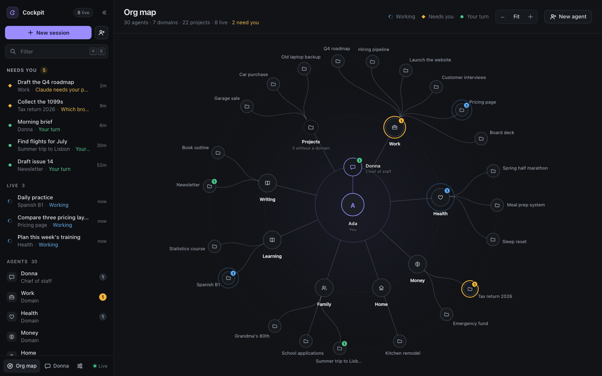
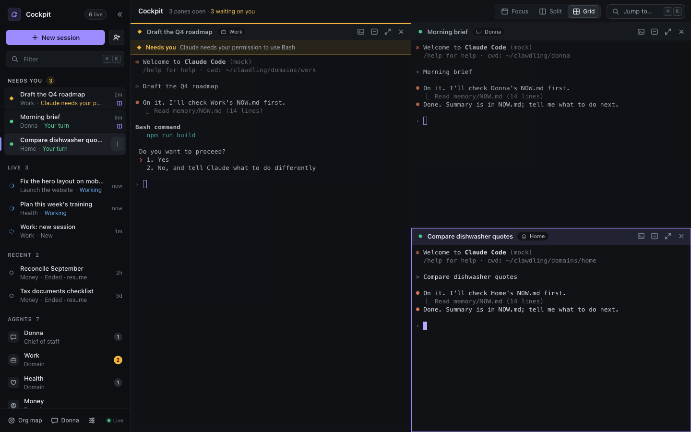
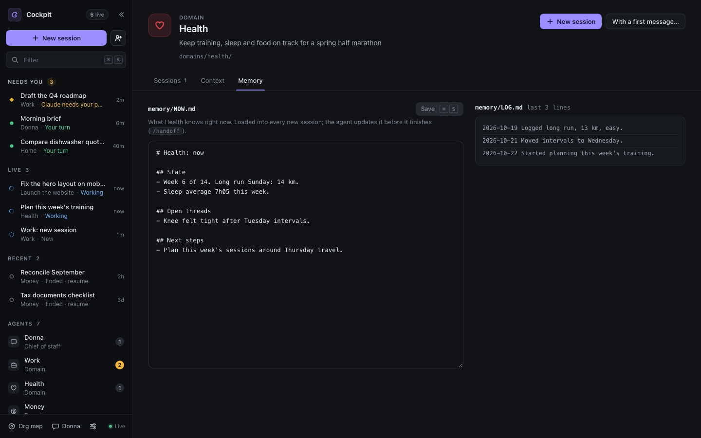

# Clawdling

[](https://github.com/jddavenportOpen/clawdling/actions/workflows/ci.yml)

**Turn Claude Code into an org of agents.** On macOS, Linux and Windows.

Hand Claude Code one link. It asks you up to five questions and builds your org: a chief of
staff you can text, an agent for each area of your life and work, and an agent for each
project. Then it gives you a cockpit where you see the whole thing and open any agent in one
click, as a real Claude Code session that already knows its job, its history and its tools.

No session caps and no per-agent fees. Every agent is the official `claude` CLI running on the
Claude plan you already pay for, so your plan's own usage limits are the only limit.



## Install it by asking Claude Code (recommended)

Open Claude Code anywhere and paste:

```
Set up Clawdling for me from https://github.com/jddavenportOpen/clawdling and follow SETUP.md
```

Claude checks your machine (macOS, Linux or Windows; no WSL needed), installs what is missing
once you say OK, clones this repo, asks up to five questions (or you pick "Use defaults"),
creates your org, starts the cockpit and opens it. [SETUP.md](SETUP.md) is the playbook it
follows; it never edits your Claude settings and never skips permission checks.

## Or install it by hand

You need **Node 20+** and **Claude Code 2.1+**, signed in (on Windows, Claude Code 2.1.139+).
**tmux 3.2+** is optional and recommended on macOS and Linux: with it, sessions keep running when
the cockpit stops (see [Sessions](#sessions-tmux-or-the-built-in-terminal)).

| | macOS | Linux | Windows 10 1809+ / 11 (native) |
|---|---|---|---|
| Node 20+ | `brew install node` or [nodejs.org](https://nodejs.org) | your package manager, [nvm](https://github.com/nvm-sh/nvm) or nodejs.org | `winget install OpenJS.NodeJS.LTS` |
| Claude Code | `curl -fsSL https://claude.ai/install.sh \| bash` | `curl -fsSL https://claude.ai/install.sh \| bash` | `irm https://claude.ai/install.ps1 \| iex` (PowerShell) |
| tmux (optional) | `brew install tmux` | `sudo apt install tmux` (or dnf, pacman, zypper, apk) | not used |
| Also | | without tmux: a C++ toolchain to build node-pty (`build-essential python3`) | Git for Windows, recommended so agents get the Bash tool: `winget install --id Git.Git -e` |

macOS and Linux:

```bash
git clone https://github.com/jddavenportOpen/clawdling ~/.clawdling-app
cd ~/.clawdling-app && npm install --omit=dev
node bin/clawdling.js doctor            # checks node, claude and how sessions will run
node bin/clawdling.js init --defaults   # or: --answers answers.json
node bin/clawdling.js start --open      # the cockpit, at http://127.0.0.1:4747
```

Windows (PowerShell; no WSL, no admin rights):

```powershell
git clone https://github.com/jddavenportOpen/clawdling "$HOME\.clawdling-app"
cd "$HOME\.clawdling-app"; npm install --omit=dev
node bin\clawdling.js doctor
node bin\clawdling.js init --defaults
node bin\clawdling.js start --open
```

No git? Download [the ZIP](https://github.com/jddavenportOpen/clawdling/archive/refs/heads/main.zip),
unzip it to `.clawdling-app` in your home folder and run the same commands from there.

The first time Claude Code starts in your org it asks whether you trust the folder. Start one
Scratch session (`node bin/clawdling.js spawn scratch`), answer "Yes" once in the cockpit, and
every agent folder inside your org is covered. A project agent whose code lives elsewhere asks
once for its repo; the cockpit shows a one-click "Yes, trust it" button.

## Sessions: tmux or the built-in terminal

Every session is the real `claude` CLI in a terminal Clawdling owns. Which terminal depends on
your machine, and `clawdling doctor` says which one you have:

- **tmux** (macOS and Linux, when tmux 3.2+ is installed): sessions live in Clawdling's own tmux
  server (`tmux -L clawdling`, never your own). Restart Clawdling, close the browser, lose Wi-Fi:
  the agents keep working and the cockpit reattaches. Attach from any terminal with the session's
  `tmux attach` command.
- **The built-in terminal** (Windows, or macOS and Linux without tmux): a pseudo-terminal per
  session from node-pty, the library VS Code's terminal uses (ConPTY on Windows). The cockpit,
  the phone app, Donna, hooks and the trust and permission buttons all work the same. The
  difference: sessions run inside the cockpit process, so **they end when the cockpit stops**.
  They come back as ended, and one click resumes each where it left off (`claude --resume`).
  `clawdling attach <sid>` opens a session in your terminal (Ctrl-] detaches).

`CLAWDLING_BACKEND=tmux` or `CLAWDLING_BACKEND=pty` picks one explicitly.

## What you get

**An org, not one more assistant.** Donna (your chief of staff), a domain agent per area
(Work, Health, Money, Home, or whatever you choose) and a project agent per project. Each agent
is a folder with a `CLAUDE.md` (who it is, what it owns, how it works) and a `memory/` it keeps
current. Your org is plain files in `~/clawdling`: read them, edit them, put them in git.

**See the whole system.** The org map draws you, Donna, your domains and their projects, with
live badges and a ring on anything that needs you. Click an agent to see what it knows and start
it.



**A cockpit that stays out of your way.**
- The rail lists every session by its real name: what needs you, what is working, what ended
  recently. Click one and it is focused next to everything else you have open; nothing gets
  replaced.
- Focus, Split or Grid layouts. `⌘K` jumps anywhere. `⌘\` collapses the rail into a strip that
  still shows one dot per live session.
- Every agent page shows its `CLAUDE.md` and `memory/NOW.md`, editable in place, so you can see
  exactly what each agent knows.

**Agents that remember.** Every session starts with the org context, the agent's `CLAUDE.md`
and its `memory/NOW.md`. Before an agent finishes it updates that memory (the `/handoff` skill
does it), so the next session picks up where the last one stopped.



**Sessions that don't die.** With tmux, every session is a real tmux session: restart
Clawdling, close the browser, lose Wi-Fi, and the agents keep working while the cockpit
reattaches. Attach from any terminal too: each session shows its exact attach command. Without
tmux (Windows, or a Mac without Homebrew), sessions end when the cockpit stops and resume with
one click.

**A chief of staff you can text.** Pair Donna with your own Telegram bot on any OS (or
iMessage, on a Mac). Text "have the health agent look at my sleep" and Donna starts the Health agent's
session, tells you who is on it, and you can watch it in the cockpit. She routes work to the
right agent instead of trying to do everything in one chat. Her tools are deliberately narrow:
she can start, message and list sessions and read your org, nothing else.

**On your phone.** The Clawdling iPhone app (chat only) connects to your own cockpit: see what
needs you, chat with any session, start one, talk to Donna. Pair it from Settings with a QR
code. The app is waiting on Apple's review; this README will link it when it is out. Until
then the cockpit itself works in a phone browser (see the FAQ for reaching it).

_Screenshots use sample data._

## How it works

```
~/clawdling/                      your org (plain files, yours)
  CLAUDE.md  me.md  org.json       context every agent inherits
  donna/  domains/<id>/  projects/<id>/    one folder per agent: CLAUDE.md + memory/
        │
        ▼
clawdling server (Node, 127.0.0.1:4747, token-protected)
  • starts the official `claude` CLI, one session per task, in that agent's folder:
    in tmux, or in a pseudo-terminal of its own (node-pty) where there is no tmux
  • streams sessions to the browser (tmux control mode, or a server-side screen model)
  • learns status from Claude Code hooks: working, needs you, your turn, ended
  • Donna's gateway: Telegram long-poll or iMessage, routes requests to agents
        │
        ▼
your browser and phone: cockpit · org map · agent pages · Donna
```

Clawdling never reads, stores or forwards your Claude credentials and never calls the Anthropic
API itself. It only launches the `claude` command you are already signed into, the same way
you would in a terminal. Session titles are made locally from your first message. Details and
the threat model are in [docs/SECURITY.md](docs/SECURITY.md); the design is in
[docs/ARCHITECTURE.md](docs/ARCHITECTURE.md).

## How it compares

| | Clawdling | Session managers (Conductor, Claude Squad, opcode) | Personal AI setups (PAI) | Assistants on their own runtime (OpenClaw, Hermes) | Claude Code's own Agent View + Channels |
|---|---|---|---|---|---|
| Unit of work | standing agents with identity and memory | git-worktree tasks | one assistant plus skills | one assistant | sessions |
| Runs on | the official `claude` CLI, your plan | the official CLI | Claude Code | their own agent loop | Claude Code |
| Whole-system view | org map plus live sessions | session list | dashboard | chat | session list |
| Text your chief of staff | yes, routed to the right agent | no | no | yes | into one open session |
| Install | paste one link into Claude Code | app or binary | installer | installer | built in |

## FAQ

**Is it unlimited?** Clawdling adds no caps and no fees. Every session uses your Claude plan,
so your plan's usage limits are the real limit. Run as many agents as your plan and your
machine allow.

**Where does my data go?** Nowhere. The cockpit binds to 127.0.0.1 and requires a local token.
Your org is files in `~/clawdling`.

**Can I reach it from my phone or another machine?** `clawdling start --host 0.0.0.0` makes it
reachable on your Wi-Fi (the token is still required); away from home, use Tailscale.

**Can I keep my existing CLAUDE.md files and skills?** Yes. Agents are folders; put anything
Claude Code understands in them.

## Development

`npm test` runs the unit and integration suites against a fake `claude` (no model calls) with
the session backend this machine would use; `npm run test:tmux` and `npm run test:pty` pick one.
CI runs both on macOS and Linux, and the built-in terminal on Windows, under Node 20 and 22.
`npm run e2e` runs the Playwright cockpit suite. `npm run smoke:live` runs one real Claude Code
session to prove context and memory preload (`CLAWDLING_BACKEND=pty npm run smoke:live` proves
it without tmux). Test users and acceptance stories are in
[docs/USER-STORIES.md](docs/USER-STORIES.md).

## License

AGPL-3.0. Built by [JD Davenport](https://jddavenport.com). Earlier versions of Clawdling (a
bring-your-own-API-key engine) live on the `legacy/byok-engine` branch.
