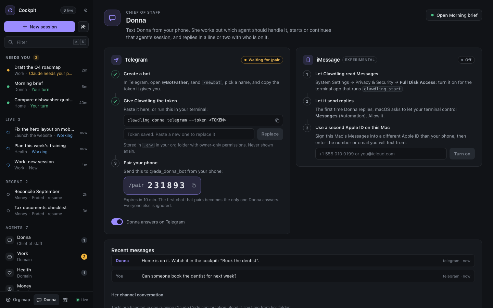

# Clawdling

[](https://github.com/jddavenportOpen/clawdling/actions/workflows/ci.yml)

**Your Claude Code, as a whole org.**

Running several Claude Code projects at once? Clawdling gives each one an agent with its own job
and memory, puts them all on one map, and shows you who's working and who needs you. When an
agent says "done", it shows the receipt, or says "not verified".


_Screenshots use sample data._

Paste this into Claude Code (a terminal, or the desktop app's Code tab):

```
Set up Clawdling for me from https://github.com/jddavenportOpen/clawdling and follow SETUP.md
```

Open source and local: it runs the official `claude` CLI on the Claude plan you already have, on
your own Mac, Linux or Windows computer. It never handles your credentials, never calls the
Anthropic API and never edits your Claude settings. Only use claude.ai in a browser?
[Start here](docs/START-HERE.md).

## What you get

**An org, not one more assistant.** Donna (your chief of staff), an agent for each area of your
work and life (Work, Health, Money, Home, or whatever you choose) and an agent for each project.
Each agent is a folder with a `CLAUDE.md` (who it is, what it owns, how it works) and a `memory/`
it keeps current. Your org is plain files in `~/clawdling`: read them, edit them, put them in git.

**See the whole system.** The org map draws you, Donna, your areas and their projects, with live
badges and a ring on anything that needs you. Click an agent to see what it knows and start it.

**Many Claude Code sessions, one cockpit.** Every agent opens in one click as a real Claude Code
session that already knows its job, its history and its tools, so you stop pasting the same
backstory into each new chat.
- The rail lists every session by its real name: what needs you, what is working, what ended
  recently. Focus, Split or Grid layouts; `⌘K` jumps anywhere.
- When Claude asks you something or wants a plan approved, the chat shows it as a card. Tool
  permissions still show Claude Code's own buttons, exactly as before.
- When a turn is over but work it started is still running in the background, the session reads
  **Watching · N** instead of Ready.
- With tmux, sessions keep running when you close the browser or restart Clawdling.
- Optional: a browser notification, or one line to your own paired chat, when an agent needs you.

**Agents that remember.** Every session starts with the org context, the agent's `CLAUDE.md` and
its `memory/NOW.md`. Before an agent finishes it updates that memory (the `/handoff` skill does
it), so the next session picks up where the last one stopped.

**A chief of staff you can text.** Pair Donna with your own Telegram bot on any OS (or iMessage,
on a Mac). Text "have the health agent look at my sleep" and Donna starts the Health agent's
session, tells you who is on it, and you can watch it in the cockpit. Her tools are deliberately
narrow: she can start, message, list and end sessions, add an agent, and read your org and its
report card. She has no other shell, no MCP servers and no writes outside her own memory.



## Don't take "done" on faith

**When an agent says "done", Clawdling shows the receipt, or says "not verified".** A developer
can read the diff; an owner needs a receipt. No model decides the label: each label is a fact
from Claude Code's own transcript, so it is free and instant.

- **Verified**: a check ran after the agent's last change and passed ("`npm test` passed at 14:02,
  after the last edit").
- **Not verified**: no check ran after the last change, or the record cannot tell. This is the
  default, and it is not an accusation: it means there is no receipt yet.
- **Contradicted**: a check ran after the last change and failed, and did not pass after. The label quotes the first error
  line, the claim waits in **Needs you**, and **Ask the agent to fix it** sends one message, which
  you see before it goes.


To get more receipts: a **ship check** per project (the commands you tick, run in a scratch copy
of the repo, never the live one), **agent check-ups** (five questions drafted from the agent's own
notes, run on your plan with the cost shown first and a cap you set) and **try a cheaper model**
(changes nothing until you click "Use this").

**The report card.** Every project gets one: what got done, what it cost, what needs you, and what
the agent says it will do next. In plain words, from files already on your computer (Claude Code's
transcripts, your repo's `git log`, the agent's memory). The cost is a list-price equivalent, not
a bill.


**Your CTO.** Add a CTO seat beside Donna and press **Run this week's review**. It reads every
project's receipts and writes one page: which projects are on track, at risk or stalled, why, and
up to three decisions for you. Every line cites its receipt; a line without one is marked
**uncited**. The labels come from fixed rules in Clawdling, not the model's opinion. It runs when
you press the button (the cost is shown first), or every Monday if you turn that on; the Monday
run stays under a weekly spend cap you set ($2 to start).


More: [the report card, Timeline and Verified done](docs/RECEIPTS.md), [the CTO](docs/CTO.md), and
how each is sandboxed in [SECURITY.md](docs/SECURITY.md#verified-done-16).

## Bring in your projects

Click **Bring in your projects** (shown on the empty cockpit, or **New agent → From a repo**) and
Clawdling looks for your projects: folders where you've used Claude Code before, git repos under
`~/code` and similar folders, and your GitHub repos too, if `gh` is signed in. GitHub is reached
only through your own `gh`: Clawdling never reads or stores a GitHub token.

Tick the ones you want, pick an area for each, and click **Create N project agents**. Each one
gets a folder in your org that points at the repo, sessions that run in the repo itself, a
`CLAUDE.md` drafted from the repo's README and its commands, and a `NOW.md` seeded from recent
commits, issues and pull requests. An import never writes into your repo, and running it again is
safe. **Deep onboard** starts a real Claude Code session, on your plan, that reads the repo and
writes better notes than the quick draft.

From a terminal: `clawdling discover` lists what it found; `clawdling import <name> --yes` creates
the agent (leave off `--yes` to see the plan first).

**Your Claude Code setup, visible.** Settings has a "Your Claude Code setup" card: the skills,
subagents, MCP servers and hooks every agent inherits, by name only. **Make it a standing agent**
turns any of your Claude Code subagents into an agent of its own.

<a id="install"></a>
## What you need, and the install

- **A Mac, Windows PC or Linux computer.** Clawdling runs on your computer, not on a phone or in a
  browser tab.
- **A paid Claude plan: Pro, Max, Team or Enterprise.** The free plan does not include Claude
  Code. **Pro works**: its usage allowance is smaller than Max's and every agent draws from it, so
  run one or two agents at a time.
- **Claude Code**, in either form:

| You use | Do this |
|---|---|
| Claude Code in a terminal (`claude`) | Paste the line below into it. |
| The **Claude desktop app** | Open its **Code** tab (choose **Local** and any folder) and paste the line below there. The app has Claude Code inside it but not the `claude` command Clawdling starts; Claude installs that with [Anthropic's official installer](https://code.claude.com/docs/en/setup) once you say OK. No admin password needed. |
| Only **claude.ai in a browser**, or the phone app | Chat cannot install anything on your computer. Get the [Claude desktop app](https://claude.com/download), sign in with the same account and use its Code tab ([how](docs/START-HERE.md#step-1-get-claude-code)). |

Then paste:

```
Set up Clawdling for me from https://github.com/jddavenportOpen/clawdling and follow SETUP.md
```

Claude checks your machine (macOS, Linux or Windows; no WSL needed), installs what is missing
(usually Node.js, and the `claude` command if you use the desktop app) once you say OK, clones
this repo, asks up to five questions (or you pick "Use defaults"), creates your org, starts the
cockpit and opens it. [SETUP.md](SETUP.md) is the playbook it follows; it never edits your Claude
settings and never skips permission checks.

Prefer a terminal? [Install it by hand](docs/INSTALL.md). Something wrong?
[Troubleshooting](docs/TROUBLESHOOTING.md), or [the same fixes in plain language](docs/START-HERE.md#when-something-goes-wrong-plain-language-fixes).

<details>
<summary>For Claude Code</summary>

Read SETUP.md in full: `curl -fsSL https://raw.githubusercontent.com/jddavenportOpen/clawdling/main/SETUP.md`
(a web fetch may hand you a summary of it instead of the file).

</details>

## How it works

```
~/clawdling/                      your org (plain files, yours)
  CLAUDE.md  me.md  org.json       context every agent inherits
  donna/  domains/<id>/  projects/<id>/    one folder per agent: CLAUDE.md + memory/
        │
        ▼
clawdling server (Node, 127.0.0.1:4747, token-protected)
  • starts the official `claude` CLI, one session per task, in that agent's folder:
    in tmux, or in a pseudo-terminal of its own (node-pty) where there is no tmux
  • streams sessions to the browser (tmux control mode, or a server-side screen model)
  • learns status from Claude Code hooks: working, needs you, your turn, ended
  • reads Claude Code's own transcripts for the chat view, the Timeline and the report card
  • Donna's gateway: Telegram long-poll or iMessage, routes requests to agents
        │
        ▼
your browser: cockpit · org map · agent pages · Donna
```

Clawdling never reads, stores or forwards your Claude credentials and never calls the Anthropic
API itself. It only launches the `claude` command you are already signed into, the same way you
would in a terminal. If you add a second Claude account in Settings, Clawdling gives it its own
folder (`~/.clawdling-accounts/<name>`) and passes that folder to `claude` as `CLAUDE_CONFIG_DIR`;
you sign in inside Claude Code, and Clawdling never sees that login. Session titles are made
locally from your first message. Details and the threat model: [docs/SECURITY.md](docs/SECURITY.md);
the design: [docs/ARCHITECTURE.md](docs/ARCHITECTURE.md).

**Use it from anywhere (optional).** Off until you turn it on: open your cockpit from your phone
or another computer through Tailscale (just your devices) or a Cloudflare Tunnel with a sign-in
(beta). Clawdling itself still listens on `127.0.0.1` only. [How](docs/REMOTE.md).

## How it compares

| | Clawdling | Session managers (Conductor, Claude Squad, opcode) | Personal AI setups (PAI) | Assistants on their own runtime (OpenClaw, Hermes) | Claude Code's own Agent View + Channels |
|---|---|---|---|---|---|
| Unit of work | standing agents with identity and memory | git-worktree tasks | one assistant plus skills | one assistant | sessions |
| Runs on | the official `claude` CLI, your plan | the official CLI | Claude Code | their own agent loop | Claude Code |
| Whole-system view | org map plus live sessions | session list | dashboard | chat | session list |
| Text your chief of staff | yes, routed to the right agent | no | no | yes | into one open session |
| Install | paste one link into Claude Code | app or binary | installer | installer | built in |

## FAQ

**Does it work on the Pro plan?** Yes. Every agent session uses your plan's usage allowance, and
Pro's is smaller than Max's, so keep one or two agents busy at a time. When you hit the limit,
Claude Code says when it resets and the sessions wait. The free plan does not include Claude Code.

**Does Clawdling add limits or fees?** No per-agent fees, and your Claude plan's usage limits
apply as usual. Two features that spend your plan on their own have caps you set: the scheduled
CTO review (a weekly cap) and check-ups (a cap per run), both $2 to start.

**Is the report card's dollar figure what I pay?** No. It is what the same usage would cost at
Anthropic's list prices, worked out on your computer from Claude Code's own transcripts. On Pro
and Max your usage is included in your plan; the figure helps you compare projects and spot a
runaway session.

**Where does my data go?** Clawdling has no servers or telemetry and sends nothing to its author.
Your org stays in files on your computer, and the cockpit binds to 127.0.0.1 with a local token.
Claude Code talks to Anthropic as usual. Telegram or iMessage, Tailscale or Cloudflare, and GitHub
through your own `gh` are used only if you turn them on. [PRIVACY.md](PRIVACY.md).

**Can I use it from my phone?** Yes: the cockpit works in a phone browser once you turn on
[Use from anywhere](docs/REMOTE.md), or you can text Donna.

**Can I keep my existing CLAUDE.md files and skills?** Yes. Agents are folders; put anything
Claude Code understands in them.

## Development

`npm test` runs the unit and integration suites against a fake `claude` (no model calls) with
the session backend this machine would use; `npm run test:tmux` and `npm run test:pty` pick one.
CI runs both on macOS and Linux, and the built-in terminal on Windows, under Node 20 and 22.
`npm run e2e` runs the Playwright cockpit suite against a mock server (`CLAWDLING_E2E_REAL=1 npm run e2e`
runs it against the real server with the fake `claude`). `npm run smoke:live` runs one real Claude Code
session to prove context and memory preload (`CLAWDLING_BACKEND=pty npm run smoke:live` proves
it without tmux). Test users and acceptance stories are in
[docs/USER-STORIES.md](docs/USER-STORIES.md). A native iPhone app is in beta: [mobile/](mobile/README.md).

## License

AGPL-3.0. Built by [JD Davenport](https://jddavenport.com). Earlier versions of Clawdling (a
bring-your-own-API-key engine) live on the `legacy/byok-engine` branch.
